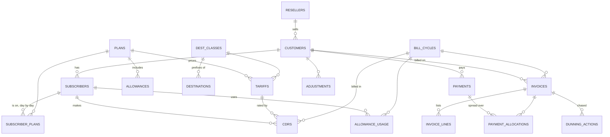

# Design notes

## Data model

`CDR_STAGING` holds raw lines until they're loaded or rejected, and
`RUN_LOG`, `BILLING_LOCKS` and `USAGE_ALERTS` support the processes.
Events go out on the `BILLING_EVENTS` Advanced Queuing queue.

## A month, end to end

1. Switches drop CSV files. `billing_load.stage_file` reads one through an
   inline external table; `stage_csv` takes the text from a client.
2. Every 15 minutes `billing_jobs.process_usage` loads staged rows into
   `cdrs`, rates them, and raises allowance alerts. Each batch commits.
3. On the 1st at 02:00 `billing_jobs.bill_last_month` rates the last
   records, bills the month in one transaction, publishes an
   `INVOICE_ISSUED` event per invoice, and allocates money on account.
4. Every day at 06:00 `billing_jobs.chase_overdue` takes the dunning
   steps due, suspending customers 60 days overdue.
5. Payments arrive through `billing_ar.record_payment`, which allocates
   them and reactivates a customer once nothing is overdue.
6. Months past retention are dropped a partition at a time with
   `billing_maint.purge_before`.

## Decisions

**Totals come from rounded lines.** Each invoice line is rounded to the
cent and the subtotal is their sum, so the printed invoice always adds
up. Usage is summed per line before rounding, not rounded per call.

**Invoices never change.** Once a cycle is billed, triggers refuse
changes to its invoices, lines and adjustments. Payments live in their
own tables, and what's owed is computed (total minus allocations), so
taking a payment never touches an invoice.

**Allocation is one statement.** Unallocated money and unpaid invoice
amounts are laid end to end as running totals (`SUM() OVER`), oldest
first, and every overlap between a payment's stretch and an invoice's
is an allocation. No loop, and the same answer however many payments
and invoices there are.

**The bill run's plan can't depend on table sizes.** The first version
joined the invoice lines to `invoices`. The optimizer drove that join
from `invoices`, pushing the join into each branch of the union, which
is the right plan when `invoices` is small. The cursor was first parsed
while the tests ran, with one invoice, and the bill run reused the plan
for 2,000: every invoice rescanned the cycle's call records. Now the lines
are numbered per customer (one invoice per customer per cycle) and each
invoice id is a unique index lookup in a scalar subquery, which Oracle
caches per customer, so the plan is the same at any size.

**User locks, not row locks.** Each process takes a `DBMS_LOCK` user lock
before it starts, so a second copy fails at once. Ordinary runs release
it at commit. The parallel rater commits after every chunk, so it holds
the lock for the whole session until the last chunk is done, which a
row lock can't do.

**Parallel by subscriber.** `rate_parallel` gives each chunk a range of
subscribers, so a line's allowance is only ever counted by one session.
Chunking by rowid would be more even, but two sessions could then use
the same allowance.

**Events are transactional.** Invoices, payments, dunning steps and
allowance alerts are enqueued with `visibility => on_commit`: a consumer
sees the event if and only if the work committed. There is no outbox
table or "sent" flag to reconcile.

**Reseller isolation is in the database.** VPD policies add the
reseller predicate to every statement on the customer facing tables once
a session sets a reseller, so a portal bug or a crafted query can't
reach another reseller's data. Billing's own sessions set nothing and
the policy functions return no predicate.

**No materialized view on call records.** A fast refreshable summary of
`cdrs` needs a materialized view log, and every rating update would
write to it: extra I/O on the busiest table to speed up reports that
already run in one pass with analytic functions.

## Editions

Partitioning, compression and VPD need Enterprise Edition on 19c, and
the Partitioning option for partitioning. Oracle Database Free, which
CI uses, has them all. On Standard Edition 2 the schema would need
`cdrs` unpartitioned and the VPD script left out.
